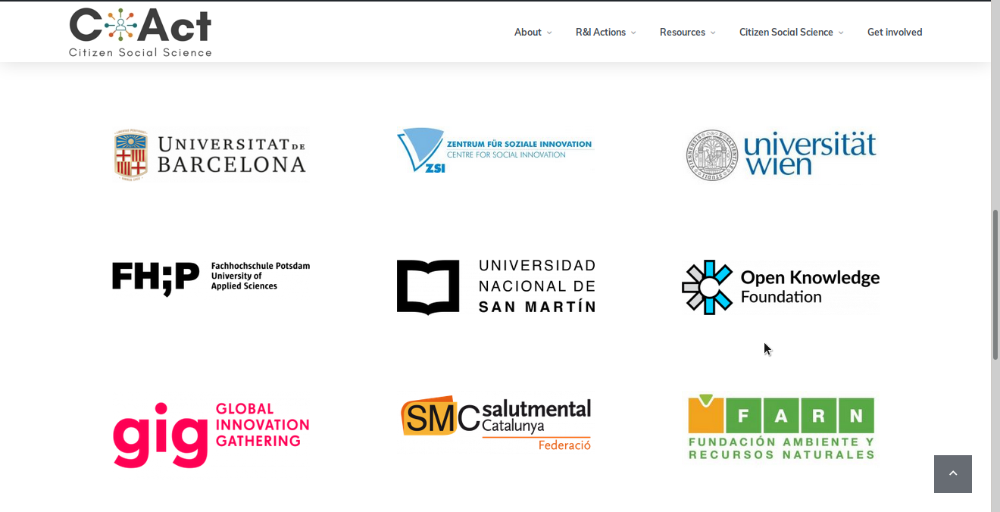
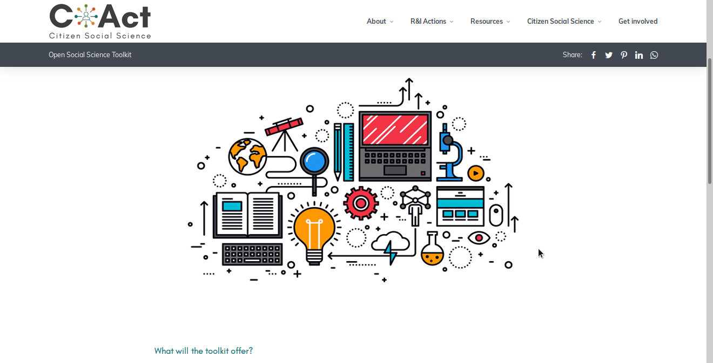
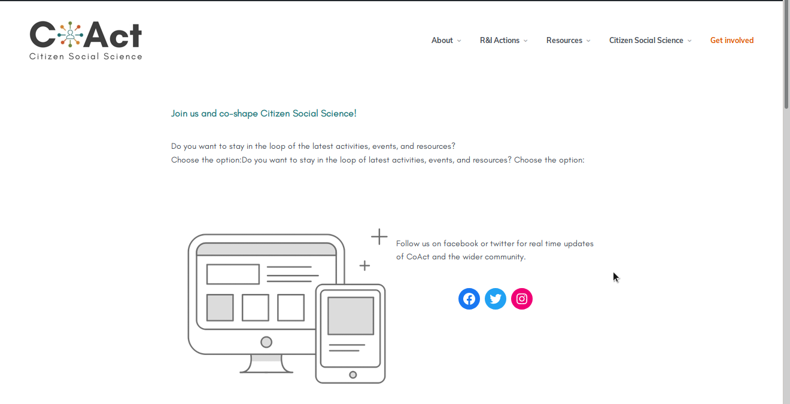

    

    

    

  

CoAct is an European Union Horizon 2020 Consortium Research proposing a new understanding of Citizen Social Science as participatory research co-designed and directly driven by citizen groups sharing a social concern, in which they become co-researchers in processes commonly dominated by academic researchers. CoAct aims to bring together and further develop methods to give citizen groups an equal ‘seat at the table’ through active participation in research, from the design to the interpretation of the results and their transformation into concrete actions.

Visit the [website](https://coactproject.eu)
