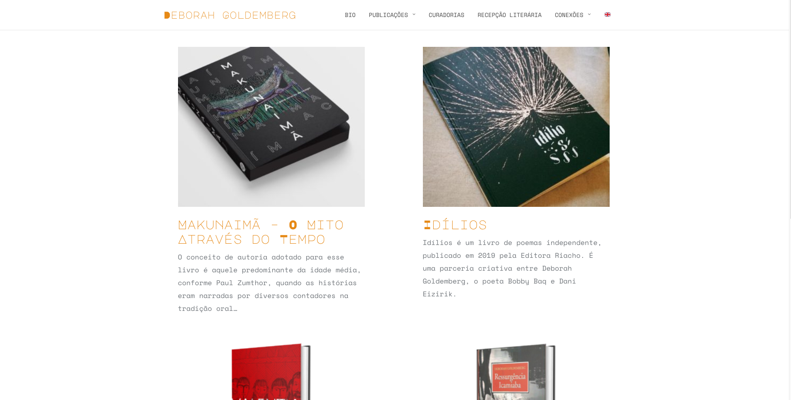
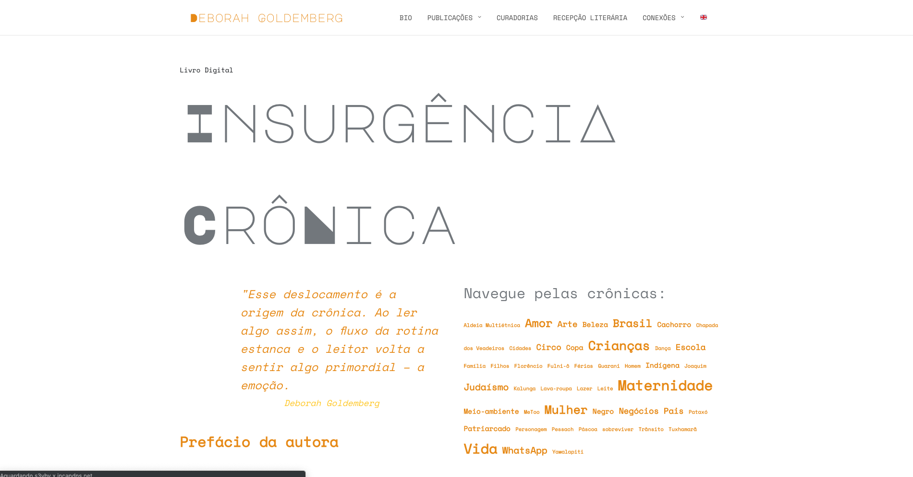
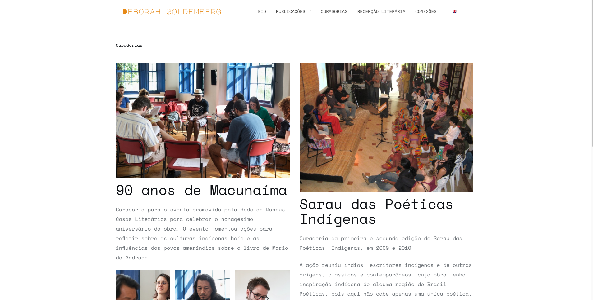

Development of web platform for  Deborah Goldemberg.

    

    

    

    

Deborah Goldemberg is an anthropologist, and an award-winning author of Valentia (Ed. Grua, 2012), winner of PROAC of the São Paulo Government / 2011, finalist of the Jabuti and Machado de Assis Awards (National Library) 2013.

Visit [deborahgoldemberg.com](https://deborahgoldemberg.com)
