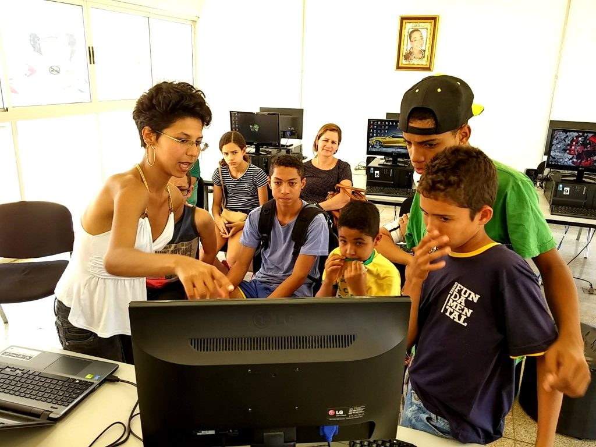
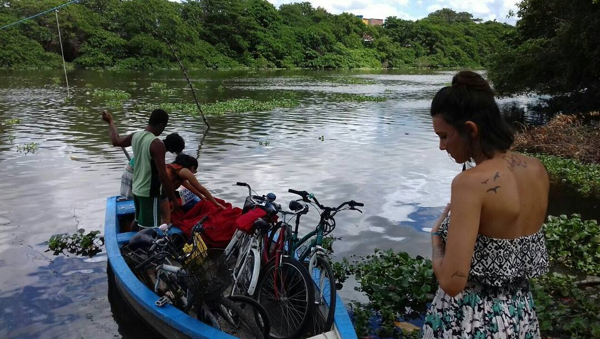
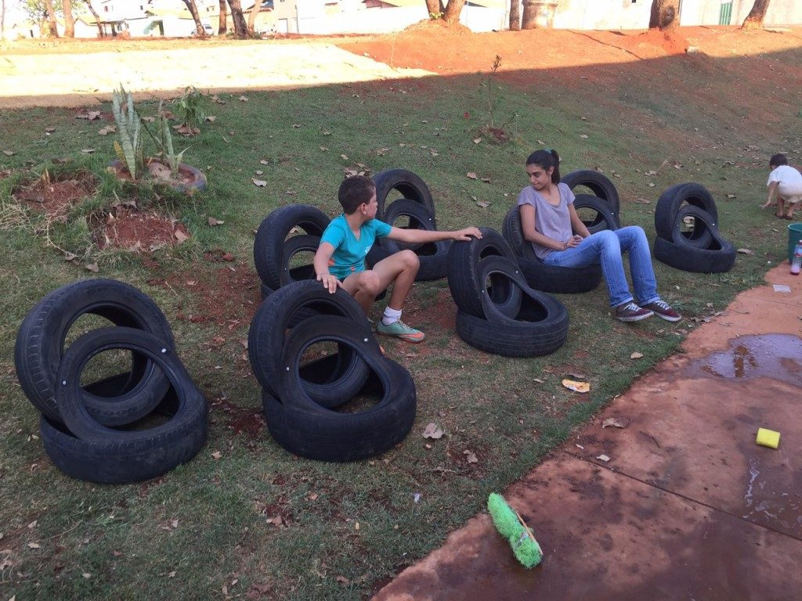

Project Management of Federal University of Pernambuco Extension Program LabCEUS.

    

    

As a result of an agreement between the Ministry of Culture and Federal University of Pernambuco, it happened in 10 small and medium-sized cities in all regions of Brazil. The pilot program developed creative experiments in arts and technology through public calls to local agents at the Unified Art and Sports Center - CEUs present on these municipalities, opening paths for citizens by offering repertoires to change the local reality.

View [project's page](https://www.instagram.com/cidadesensitiva/)
