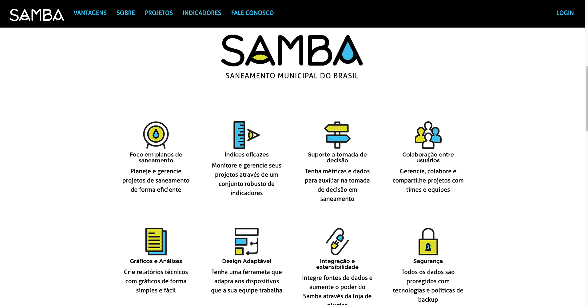

    

    

    

    

SAMBA - Municipal Sanitation of Brazil collaborative platform is a tool that proposes simplicity and agility in the elaboration of a deep and representative diagnosis of the current situation of basic sanitation services offered in a city using AI and distributed databases.
