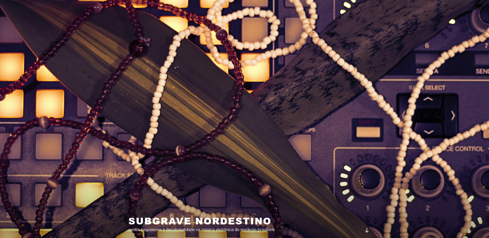

    

    
A platform for publication of research on traditional and electronic music developed within the post-graduate programme in music at the Federal University of Paraíba, UFPB, in Ethnomusicology. [Visit the website](https://subgravenordestino.com/)
